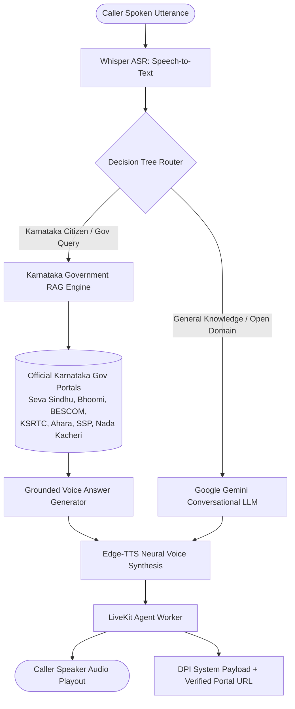

# Awaaz Setu (ಆವಾಜ್ ಸೇತು)

> **Voice-First Access Layer for Citizen Services & Karnataka Government Welfare Schemes**  
> Powered by WebRTC (LiveKit), a Hierarchical Decision Tree, and a High-Precision RAG Grounded Strictly in Official Government of Karnataka Portals.

---

## 🏛️ System Architecture & Workflow

A caller dials into Awaaz Setu through a WebRTC Phone Dialer. As they speak, their speech is transcribed and routed through an intelligent **Decision Tree Router**:



---

## 🌳 Decision Tree Logic: RAG vs. Google Gemini

The Decision Tree evaluates every query through deterministic hierarchical evaluation:

| Branch | Domain Scope | Action | Confidence | Examples |
| :--- | :--- | :--- | :--- | :--- |
| **Branch 1: Karnataka Guarantees** | State 5 Guarantees | **Route to RAG** | `0.98` | Gruha Lakshmi (₹2,000/mo), Gruha Jyothi (200 free units), Yuva Nidhi (graduate stipend), Anna Bhagya (food grains/DBT), Shakti (free bus travel). |
| **Branch 2: Land & Property** | Revenue & Panchayats | **Route to RAG** | `0.95` | Bhoomi RTC/Pahani download, mutation status, e-Swathu Form 9 & Form 11 rural property records. |
| **Branch 3: Agriculture & Welfare** | Farming & Irrigation | **Route to RAG** | `0.92` | Ganga Kalyana borewell subsidies, Raitha Siri millet incentives, Pashu Bhagya cattle loans. |
| **Branch 4: Citizen Portals** | E-Governance & Certificates | **Route to RAG** | `0.90` | Seva Sindhu 800+ services, Nada Kacheri caste/income certificates, Kutumba Family ID, SSP scholarships, Arogya Karnataka. |
| **Branch 5: Open Domain / General** | Non-Karnataka Queries | **Route to Gemini** | `0.95` | Science, world history, mathematics, programming, general reasoning, global geography. |
| **Branch 6: Conversational Chitchat**| Greetings & Help | **Route to Gemini** | `0.90` | "Hello", "Good morning", "Who are you?", "What can you do?". |

---

## 🌐 Official Karnataka Government Websites Covered in RAG

All RAG responses cite and ground facts in verified official portals:

1. **Seva Sindhu**: `https://sevasindhu.karnataka.gov.in` (Single-window 800+ citizen services, 5 guarantees)
2. **Bhoomi Portal**: `https://bhoomi.karnataka.gov.in` (Digitized land RTC, Pahani, Mutation, Village maps)
3. **BESCOM / Energy Dept**: `https://bescom.karnataka.gov.in` (Gruha Jyothi free electricity up to 200 units)
4. **KSRTC / Transport Dept**: `https://ksrtc.in` (Shakti Scheme free bus travel for Karnataka women)
5. **Ahara Portal**: `https://ahara.kar.nic.in` (Anna Bhagya food grains and DBT cash transfer status)
6. **Raita Mitra**: `https://raitamitra.karnataka.gov.in` (Raitha Siri millet incentives, Krishi Bhagya farm ponds)
7. **Dr. B.R. Ambedkar Corporation**: `https://drbrambedkar.karnataka.gov.in` (Ganga Kalyana borewell subsidies)
8. **Nada Kacheri (AJSK)**: `https://nadakacheri.karnataka.gov.in` (Caste, Income, Domicile certificates)
9. **SSP Karnataka**: `https://ssp.postmatric.karnataka.gov.in` (Pre-matric and Post-matric scholarships)
10. **DSSP Karnataka**: `https://dssp.karnataka.gov.in` (Sandhya Suraksha ₹1,000 old age pensions)
11. **e-Swathu Portal**: `https://eswathu.karnataka.gov.in` (Gram Panchayat Form 9 & Form 11 property records)
12. **Kutumba Portal**: `https://kutumba.karnataka.gov.in` (Unified resident family entitlement ID)
13. **AHVS Karnataka**: `https://ahvs.karnataka.gov.in` (Pashu Bhagya dairy & sheep livestock loan subsidies)
14. **Arogya Karnataka / SAST**: `https://arogya.karnataka.gov.in` (Cashless healthcare up to ₹5 lakh for BPL)

---

## 🚀 Running the Project

### Prerequisites
- Python 3.10+ (tested on Python 3.12 / 3.14)
- Node.js 18+ & npm
- A free Google AI Studio key (`GEMINI_API_KEY`) and LiveKit Cloud credentials in `backend/.env`.

---

### Step 1: Start the Voice Engine (Port 8000)
Terminal 1:
```powershell
# Set root directory
cd c:\Users\USER\Awaz-Satu

# Run the Voice Engine (FastAPI orchestrator with Karnataka RAG & Decision Tree)
$env:PYTHONPATH="c:\Users\USER\Awaz-Satu"
python app/main.py
```
> Voice Engine is live at: `http://localhost:8000`  
> Interactive OpenAPI Docs: `http://localhost:8000/docs`  
> Decision Tree Inspector: `POST http://localhost:8000/api/decision-tree/evaluate`  
> Direct Karnataka RAG Query: `POST http://localhost:8000/api/rag/query`  

---

### Step 2: Start the Token Server (Port 8001)
Terminal 2:
```powershell
cd c:\Users\USER\Awaz-Satu
$env:PYTHONPATH="c:\Users\USER\Awaz-Satu"
python -m uvicorn backend.token_server:app --port 8001 --reload
```
> Token Server is live at: `http://localhost:8001`  
> Health probe: `http://localhost:8001/health`  

---

### Step 3: Start the LiveKit Voice Agent Worker
Terminal 3:
```powershell
cd c:\Users\USER\Awaz-Satu
$env:PYTHONPATH="c:\Users\USER\Awaz-Satu"
python backend/agent.py dev
```
> Agent worker connects to LiveKit Cloud room and pipes incoming caller audio directly to the Voice Engine.

---

### Step 4: Start the Frontend Phone Dialer (Port 5173)
Terminal 4:
```powershell
cd c:\Users\USER\Awaz-Satu\frontend
npm install
npm run dev
```
> Open browser at: `http://localhost:5173`  
> Enter your telephone number on the Virtual Phone Dialer and click **"Call Agent"** to test live voice conversation!

---

## 🧪 Running Automated Tests

Run the complete test suite (60 unit and integration tests):

```powershell
cd c:\Users\USER\Awaz-Satu
$env:PYTHONPATH="c:\Users\USER\Awaz-Satu"

# 1. Test Karnataka RAG & Decision Tree Routing
python tests/test_karnataka_rag_and_decision_tree.py

# 2. Test Multilingual LLM & Voice Pipeline
python tests/test_multilingual_llm_pipeline.py

# 3. Test Caller Phone Whitelisting & LiveKit Token Issuance
python tests/test_phone_validation.py

# 4. Test Complete Voice Conversation Pipeline
python tests/test_voice_conversation_pipeline.py
```

---

## 📦 Pushing to GitHub on a New Branch

To push this completed feature branch to GitHub:

```bash
# 1. Check current status
git status

# 2. Stage all updated and newly created files
git add app/ backend/ frontend/ tests/ README.md

# 3. Commit with a structured message
git commit -m "feat(rag): implement Karnataka Government RAG, Decision Tree router, and UI citations"

# 4. Push the branch to GitHub
git push -u origin feature/karnataka-rag-gemini-router
```
