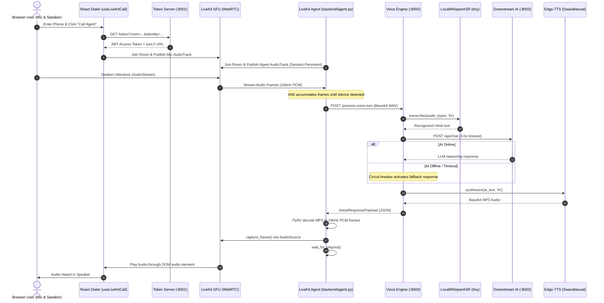

# Architecture Decision Log (ADL) — Awaaz Setu

## Status
Active / Maintained

---

## 1. Context & Overview
Awaaz Setu provides a toll-free, voice-first access layer for rural citizens needing agricultural, livestock, and government scheme advisory in Indian languages. To achieve sub-second latency and zero software licensing cost, the architecture is decoupled into a modular WebRTC signaling/media layer and an in-memory Voice Orchestra pipeline.

---

## 2. Service Registry & Port Allocations

| Service Name | Component / Entrypoint | Default Port | Protocol | Description |
| :--- | :--- | :--- | :--- | :--- |
| **Voice Engine** | `app.main:app` | `8000` | HTTP / REST | Voice pipeline orchestrator (Whisper ASR, AI agent bridge, Edge-TTS synthesis). |
| **Token Server** | `backend.token_server:app` | `8001` | HTTP / REST | LiveKit WebRTC room token generator and health probe. |
| **AI Conversational Service** | `http://localhost:8003/api/chat` | `8003` | HTTP / JSON | External LLM / RAG service for domain query reasoning (with circuit breaker fallback). |
| **Frontend Dialer** | `frontend/` (Vite) | `5173` | HTTP / WS | WebRTC browser dialer UI for testing and call-center emulation. |
| **LiveKit Agent Worker** | `backend/agent.py` | N/A (Worker) | WebRTC / RPC | LiveKit room worker subscribing to caller audio and piping to Voice Engine. |

---

## 3. Data Governance & Privacy Policies

### 3.1 Zero-Audio Retention Policy
- **Strict Mandate**: No raw audio recordings, audio streams, or intermediate audio files may be persisted to non-volatile storage (disk, cloud buckets, or databases) unless explicitly required and authorized by project leadership.
- **In-Memory Streaming**: All audio transformations (PCM to WAV, MP3 decoding, resampling) must use memory-buffered byte streams (`io.BytesIO()`) and ephemeral buffers.
- **Transient Lifetime**: Memory buffers must be released immediately once a voice turn completes or a session terminates.

### 3.2 PII Masking Guidelines
- **Telephone Numbers**:
  - Telephony identifiers and caller phone numbers must be masked in all application log records across all environments.
  - Standard masking format: retain country code prefix and last 4 digits (e.g., `+91XXXXXX3210` or `******3210`).
- **Sensitive Identifiers**:
  - Never log raw speech audio, Base64 audio payloads, API keys, JWT access tokens, passwords, or live credentials.
  - Health check endpoints must expose boolean status flags only (e.g., `credentials_configured: true`), never raw secret values or configuration dumps.

---

## 4. Architectural Decisions

### ADR 001: Separation of Voice Engine and Signaling Gateway
- **Decision**: Decouple the Voice Engine (`app/main.py` on port 8000) from WebRTC signaling (`backend/token_server.py` on port 8001) and agent workers (`backend/agent.py`).
- **Rationale**: Enables independent scaling of compute-intensive ASR/TTS models from high-concurrency network signaling. Allows future telephony adapters (SIP, Asterisk, FreeSWITCH) to consume the Voice Engine without modifying the WebRTC stack.

### ADR 002: Dedicated Port for AI Service (Port 8003)
- **Decision**: Configure downstream conversational AI query routing to default to port 8003 via `AI_SERVICE_URL`.
- **Rationale**: Resolves port collision where both the Token Server and downstream AI were previously targeting port 8001.

### ADR 003: Replaceable Telephony Adapter Strategy
- **Decision**: Keep the core voice pipeline accessible via standard HTTP REST (`POST /process-voice-turn`).
- **Rationale**: Telephony ingress (browser WebRTC, softphone SIP, or carrier PSTN) remains a peripheral adapter layer. The AI core requires zero rewrites when switching transport layers.

### ADR 004: Playout Synchronization and Session-Persistent Audio Track
- **Decision**: Publish a single `LocalAudioTrack` on session entry and synchronize synthesized speech playback using `await audio_source.wait_for_playout()`.
- **Rationale**: Dynamically publishing and unpublishing tracks per response triggered WebRTC SDP renegotiation and client-side track detaches that severed audio mid-utterance. Retaining the session track and awaiting buffer playout guarantees complete audio delivery while allowing subsequent utterances to play seamlessly.

### ADR 005: Distinction Between AI Timeout (3.0s) and Total Voice-Turn Latency (~4.7s)
- **Decision**: Maintain the strict 3.0-second network circuit-breaker timeout on downstream AI queries (`query_ai_agent`), while recognizing that end-to-end voice-turn latency reflects the sum of all pipeline stages.
- **Profiling Breakdown**:
  $$\text{Total Turn Latency} = T_{\text{decode}} + T_{\text{Whisper ASR}} + T_{\text{AI Query / Fallback}} + T_{\text{Edge-TTS}} + T_{\text{serialize}}$$
  - In fallback mode (port 8003 offline), the downstream AI query incurs the full 3.0s network timeout.
  - Whisper local ASR on CPU takes ~1.1–1.2s.
  - Edge-TTS neural synthesis takes ~0.4–0.5s.
  - Sum: $\approx 4.7\text{ seconds}$. When an active AI service responds in $\le 300\text{ ms}$, total latency drops to $\approx 1.8\text{ seconds}$. The 3.0s timeout is a safety boundary, not pipeline latency.

### ADR 006: Interruption Handling & Queue Cancellation
- **Decision**: Call `audio_source.clear_queue()` when incoming speech energy exceeds `SILENCE_THRESHOLD` or when participant leaves.
- **Rationale**: If a caller begins speaking while previous AI speech is playing, the pending queue is purged immediately, preventing overlapping acoustic feedback and stale audio playback.

### ADR 007: Authoritative Server-Side Caller Validation & Identity Decoupling
- **Decision**: Validate dialed caller telephone numbers server-side against the `ALLOWED_CALLER_NUMBER` environment variable before issuing LiveKit tokens or establishing WebRTC sessions.
- **Normalization Rules**:
  - Strip leading/trailing and internal whitespace, hyphens, parentheses, and dots.
  - Consistently strip optional leading `+` before comparing.
  - Enforce strict exact equality; partial, prefix, or substring matches are strictly rejected with HTTP 403 Forbidden ("Invalid number").
- **Identity Decoupling**:
  - `backend/agent.py` passes the validated configured telephone number (`ALLOWED_CALLER_NUMBER`) as `user_phone` to the Voice Engine rather than deriving it from a random WebRTC participant identity (e.g. `caller-z75pwn`).
- **Privacy Enforcement**:
  - Secret telephone numbers are never bundled into or leaked to the client bundle.
  - Health check endpoints expose boolean flags only (`allowed_caller_configured: true`).

### ADR 008: Dynamic Intent Routing, VAD Ring Buffering & Elimination of Startup Demo Triggers
- **Decision**: Eliminate unconditional startup demo DPI publishing in `backend/agent.py`.
- **Dynamic Intent Routing**: Route transcribed queries to `e-NAM Mandi Prices (demo)`, `PM-Kisan Samman Nidhi`, `Pashu Palan & Livestock Advisory`, `IMD Weather Advisory`, or `Awaaz Setu General Advisory`.
- **VAD Pre-Speech Ring Buffer**: Maintain a 10-frame (~200ms) pre-speech ring buffer in `read_caller_audio` to eliminate leading consonant truncation.
- **Silence & Retry Prompts**: Empty or unintelligible utterances return `dpi_service=None` and trigger a spoken retry prompt without dispatching false DPI results.
- **Token Metadata Integration**: The Token Server embeds the validated telephone number in LiveKit token metadata (`{"phone": "..."}`), ensuring caller identity is cleanly decoupled from WebRTC participant identities.

### ADR 009: Multilingual Speech Recognition (Groq Whisper LPU) and Conversational LLM (Google Gemini Free-Tier)
- **Decision**: Introduce optional hosted high-speed Whisper speech recognition via Groq (`whisper-large-v3-turbo`) and conversational reasoning via Google Gemini API (`gemini-1.5-flash` / `gemini-2.0-flash` free tier), backed by deterministic offline fallbacks.
- **Architectural Tenets**:
  1. **Batch Utterance Semantics**: LiveKit agent VAD captures complete spoken utterances before sending them to the Voice Engine. Groq LPUs transcribe complete 1-5 second utterances in ~150-250ms with high multilingual accuracy (Kannada, Hindi, English).
  2. **ASR Circuit Breaker**: If `ASR_PROVIDER=groq` encounters HTTP 429 (rate limit), request timeout, network error, or missing key, it immediately and seamlessly falls back to `LocalWhisperASR` (CPU Whisper).
  3. **Caller Session Isolation**: `CallerSessionManager` isolates multi-turn conversation memory by caller telephone number (`user_phone`). Memory is strictly bounded to a sliding window of 6 turns (3 caller turns, 3 assistant turns) to prevent context bloat and eliminate cross-caller data leakage.
  4. **Spoken IVR System Prompt Grounding**: Responses are strictly constrained to 1–3 short sentences without markdown formatting, bullets, asterisks, numbered lists, emojis, or URLs. Replies must match the input language (conversational Kannada, Hindi, English, Hinglish, or Kanglish) and are strictly barred from hallucinating live mandi prices or unverified scheme disbursement dates.
  5. **Dynamic Neural TTS Voice Routing**: `detect_script_language` inspects Unicode codepoints in the generated response: Kannada (`\u0C80`–`\u0CFF`) routes to `kn-IN-GaganNeural`, Devanagari (`\u0900`–`\u097F`) routes to `hi-IN-SwaraNeural`, and Latin script routes to `en-IN-NeerjaNeural`.
  6. **Zero-Audio Retention & Strict Fallback**: Free-tier API keys remain backend-only. If Gemini returns HTTP 429 (quota exhaustion) or fails, the engine falls back to `classify_intent` without disrupting the caller. If TTS fails, text responses are preserved for UI display and HTTP 500 is never returned.

---

## 5. Component Ownership & Verified Live Flow

---

## 6. Test Evidence & Known Limitations

### Verified Automated Tests (`tests/test_phase2_voice_pipeline.py`)
- **ASR Verification**: `LocalWhisperASR` loads audio in-memory and executes transcription without disk writes.
- **AI Circuit Breaker**: Offline port 8003 trips 3.0s timeout and serves agricultural fallback response with phone number masked.
- **TTS Synthesis**: Edge-TTS synthesizes Hindi audio into valid MP3 Base64 stream.
- **Full Engine Turn**: `/process-voice-turn` executes end-to-end and returns complete schema with latency profile.
- **Input Validation**: Malformed Base64 and injection room names return HTTP 400/422.
- **Silence & VAD**: PCM-to-WAV conversion and RMS thresholding verified on speech vs silence.
- **Multi-Turn Continuity**: Two consecutive voice turns execute back-to-back without session bleed.
- **Token Server Health & Security**: Health probe returns `200 OK` with credentials flag; zero secrets leaked.

### Known Environmental Limitations
- **LiveKit Cloud / Self-Hosted Server Required for Browser Calls**: `backend/agent.py` and the React frontend require either LiveKit Cloud project keys in `backend/.env` or a local running `livekit-server` instance. Unit and pipeline tests execute offline using mocks.
